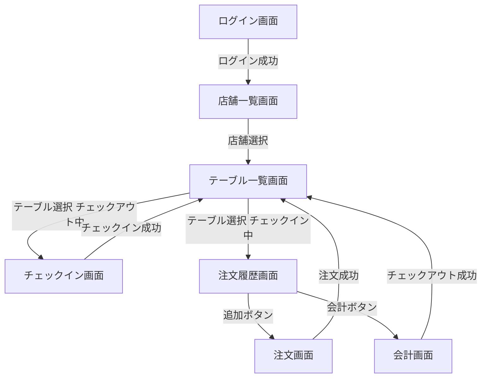

# 画面仕様書

画面仕様を定義する
画面遷移には[go_router](https://pub.dev/packages/go_router)を利用する

## 画面遷移図

## 共通

### ローディング / エラー / 空データの表示

- ローディング: 処理中（API 呼び出し中）は画面中央にプログレスインジケータを表示する。
- 空データ: リストが空の場合は説明テキストとアクション（例: 再読み込みボタン）を表示する。
- エラー: エラー時はダイアログでエラーを表示し、必要に応じてリトライを提供する。

### ナビゲーション期待動作

- バック操作: 画面の戻る操作は直前の画面へ戻る（ログイン直後はアプリ終了としない）

## ログイン画面

### 表示項目

なし。

### 画面状態モデル

1. **未ログイン** – 初期表示。
2. **認可中/待機** – プログレスインジケータを表示。
3. **認証済み** – トークン取得が済んだら店舗一覧画面へ遷移。

### 機能

- トークン取得処理
- 取得成功後、店舗一覧画面へ遷移

## 店舗一覧画面

### 表示項目

表示項目は以下

- ヘッダー（タイトルを表示）
- 店舗一覧リスト

#### 店舗一覧リスト

| 項目名　   | 表示形式       | 説明                                                                         |
| ---------- | -------------- | ---------------------------------------------------------------------------- |
| テーブル行 | リストアイテム | 店舗を表し、店舗名を表示する。押下時はその店舗のテーブル一覧画面を取得する。 |

### 機能

- 店舗一覧取得

## テーブル一覧画面

### 表示項目

表示項目は以下

- ヘッダー（タイトルを表示）
- テーブル一覧リスト

#### テーブル一覧リスト

| 項目名　   | 表示形式       | 説明                                                                                                                                                                                 |
| ---------- | -------------- | ------------------------------------------------------------------------------------------------------------------------------------------------------------------------------------ |
| テーブル行 | リストアイテム | テーブルを表し、テーブル名とチェックイン中の場合はチェックイン人数を表示する。押下時は状態に応じて遷移する（チェックアウト時: チェックイン画面へ、チェックイン中: 注文履歴画面へ）。 |

### 機能

- テーブル一覧取得

## チェックイン画面

### 表示項目

| 項目名　           | 表示形式       | 　説明                                                       |
| ------------------ | -------------- | ------------------------------------------------------------ |
| ヘッダー           | ヘッダー       | タイトルを表示                                               |
| 人数入力欄         | 入力欄（数値） | 　チェックイン時の人数として、1以上9以下の整数を可能にする。 |
| チェックインボタン | ボタン         | チェックイン処理を実行する                                   |

### 機能

- チェックイン

## 注文履歴画面

### 表示項目

| 項目名　                   | 表示形式       | 説明                                                       |
| -------------------------- | -------------- | ---------------------------------------------------------- |
| ヘッダー                   | ヘッダー       | タイトルを表示                                             |
| 注文履歴リスト　テーブル行 | リストアイテム | 注文履歴のメニューを表し、メニュー名と注文点数を表示する。 |
| 追加ボタン                 | ボタン         | メニュー一覧画面に遷移する                                 |
| 会計ボタン                 | ボタン         | 会計画面に遷移する                                         |

### 機能

- 注文履歴確認
- 注文取り消し

## 注文画面

### 表示項目

表示項目は以下

- ヘッダー
- メニューリスト
- 注文リスト

#### ヘッダー

| 項目名　 | 表示形式 | 説明           |
| -------- | -------- | -------------- |
| タイトル | テキスト | タイトルを表示 |

#### メニューリスト

| 項目名　       | 表示形式       | 説明                                                                                          |
| -------------- | -------------- | --------------------------------------------------------------------------------------------- |
| メニュー行     | リストアイテム | メニューを表し、メニュー名を表示する                                                          |
| 点数           | 入力欄         | メニュー行上に表示。点数を1以上9以下で入力可能にする。                                        |
| 点数増加ボタン | ボタン         | メニュー行上に表示。押下することで注文点数を1増加する。増加できない場合はグレーアウトにする。 |
| 点数減少ボタン | ボタン         | メニュー行上に表示。押下することで注文点数を1減少する。減少できない場合はグレーアウトにする。 |
| 追加ボタン     | ボタン         | メニュー行上に表示。 押下することで、メニューを注文リストに追加する                        |

#### 注文リスト

| 項目名　   | 表示形式       | 説明                                                                                                       |
| ---------- | -------------- | ---------------------------------------------------------------------------------------------------------- |
| 注文行     | リストアイテム | メニューリストで追加したメニューを表す。メニュー名と点数を表示し、スワイプ操作で削除可能にする。           |
| 注文ボタン | ボタン         | 押下することで注文処理を実行する。成功時はテーブル一覧画面に遷移し、エラー時はエラーダイアログを表示する。 |

### 機能

- メニュー一覧取得
- 注文

## 会計画面

### 表示項目

| 項目名　             | 表示形式   | 説明                                 |
| -------------------- | ---------- | ------------------------------------ |
| ヘッダー             | ヘッダー   | タイトルを表示                       |
| 金額                 | テキスト　 | 合計金額を表示                       |
| チェックアウトボタン | ボタン     | 会計処理を行い、チェックアウトを行う |

### 機能

- 会計
